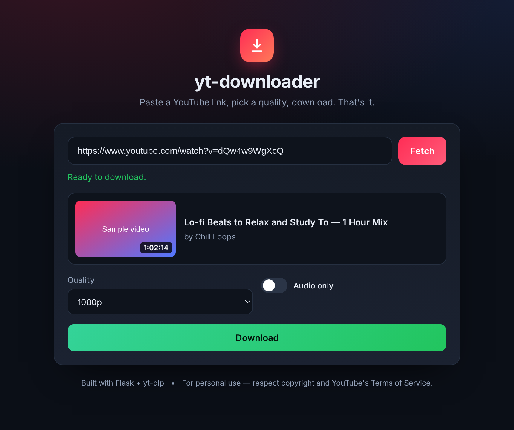

<div align="center">

# yt-downloader

**Paste a YouTube link, pick a quality, download. That's it.**

A small, self-hosted web app built with Flask + [yt-dlp](https://github.com/yt-dlp/yt-dlp).
No database, no build step, no clutter — just a clean dark UI and a download.



</div>

---

## Features

- **Paste-and-go** — drop in any YouTube URL and get an instant preview
  (thumbnail, title, channel, duration).
- **Quality control** — Best available, 2160p (4K), 1440p, 1080p, 720p, 480p, 360p.
- **Audio-only mode** — rip just the sound as **MP3**, **M4A** or **WAV**.
- **Streams straight to your browser** — the server downloads, hands you the file,
  then deletes its temporary copy automatically.
- **Safe by default** — only YouTube hosts are accepted, so the server can't be
  abused as an open proxy.
- **Docker ready** and covered by tests + CI.

## Requirements

- **Python 3.10+**
- **ffmpeg** — *strongly recommended*. Without it, yt-dlp can't merge separate
  video and audio streams, so quality is capped at the best pre-merged file
  (usually 720p) and MP3/WAV conversion is unavailable.
- **An external JavaScript runtime** — installed automatically by
  `yt-dlp[default,deno]` (a Deno runtime plus the EJS challenge scripts).
  Since yt-dlp **2025.11.12** a JS runtime is *required* for YouTube, because
  yt-dlp has to solve YouTube's JavaScript challenges. Plain `yt-dlp` is no
  longer enough — if you install manually, use `pip install "yt-dlp[default,deno]"`.

## Quick start

```bash
git clone https://github.com/theadvay/yt-downloader.git
cd yt-downloader

python -m venv .venv
source .venv/bin/activate      # Windows: .venv\Scripts\activate

pip install -r requirements.txt
python app.py
```

Then open **http://127.0.0.1:5000** in your browser.

### Installing ffmpeg

| Platform | Command |
| --- | --- |
| Debian / Ubuntu | `sudo apt install ffmpeg` |
| macOS (Homebrew) | `brew install ffmpeg` |
| Windows (winget) | `winget install Gyan.FFmpeg` |
| Windows (Chocolatey) | `choco install ffmpeg` |

## Run with Docker

```bash
docker build -t yt-downloader .
docker run --rm -p 5000:5000 yt-downloader
```

The image bundles ffmpeg, so everything works out of the box.

## Deploy it

The bundled `Dockerfile` (with ffmpeg) runs as-is on any container host.

> **Keep yt-dlp fresh.** YouTube changes often and yt-dlp ships fixes within
> hours. Redeploy every few weeks (or push any commit) so the image rebuilds
> with the latest yt-dlp — a stale build is the most common cause of sudden
> breakage. `/api/health` reports the version currently running.

### Render — recommended, genuinely free

This repo includes a `render.yaml` Blueprint, so it's a one-click deploy:

1. In the [Render Dashboard](https://dashboard.render.com), click **New → Blueprint**.
2. Connect this repo and click **Deploy Blueprint**.
3. Render builds the Dockerfile and gives you a `https://<name>.onrender.com` URL.

Free-plan caveats worth knowing up front:

- The service **spins down after 15 minutes** without traffic and takes about a
  minute to wake on the next request.
- Free instances have **512 MB RAM** — fine for 720p/1080p, but a 4K merge can
  run out of memory.
- Each workspace gets **750 instance hours/month** (a month is ~744 h, so one
  always-on service just fits) and **5 GB/month of outbound bandwidth**. Video
  downloads count against that, so expect roughly 25–50 downloads a month.

### Railway

Railway builds the same Dockerfile with no extra config:

1. [railway.com](https://railway.com) → **New Project → Deploy from GitHub repo**.
2. Pick this repo — Railway detects the Dockerfile and builds it.

Railway's free tier is a one-time **$5 credit for 30 days**; after that the Free
plan gives **$1/month**, which is not enough to keep this app running 24/7. The
**Hobby plan ($5/month)** is the realistic choice if you want it always awake.

### On a cloud host you'll probably need cookies

Render, Railway, Vercel and friends all use datacenter IPs, and YouTube tends to
answer those with *"Sign in to confirm you're not a bot"* or *"Failed to extract
any player response"*. The Docker image already handles the JS-runtime half of
this problem; the remaining half is proving you're a real signed-in user, which
means cookies. Note that `YTDLP_COOKIES_FROM_BROWSER` only works when the app
runs on **your own machine** — on a server, use an exported `cookies.txt`:

- On Render, add a **Secret File** named `cookies.txt`, then set the
  `YTDLP_COOKIES` env var to its mount path (`/etc/secrets/cookies.txt`).
- Cookies expire, so plan to refresh that file every few weeks.

## Configuration

The app reads a few environment variables:

| Variable | Default | Purpose |
| --- | --- | --- |
| `HOST` | `127.0.0.1` | Interface to bind (`--host` also works). |
| `PORT` | `5000` | Port to listen on (`--port` also works). |
| `YTDLP_COOKIES` | – | Path to a Netscape-format `cookies.txt`. |
| `YTDLP_COOKIES_FROM_BROWSER` | – | Browser to pull cookies from, e.g. `chrome`, `firefox`. |

### "Sign in to confirm you're not a bot"

YouTube sometimes shows this for datacenter or shared IPs (cloud servers, VPNs).
Passing cookies fixes it:

```bash
# Use cookies from your local browser (no export needed)
YTDLP_COOKIES_FROM_BROWSER=firefox python app.py

# Or point at an exported cookies.txt file
YTDLP_COOKIES=/path/to/cookies.txt python app.py
```

## HTTP API

The front-end is just a thin client over four endpoints — script it if you like.

| Method | Path | Body / Notes |
| --- | --- | --- |
| `GET` | `/` | The web UI. |
| `GET` | `/api/health` | `{"ok": true, "ffmpeg": true}` |
| `POST` | `/api/info` | `{"url": "..."}` → video metadata. |
| `POST` | `/api/download` | `{"url": "...", "quality": "1080", "audio_only": false, "audio_format": "mp3"}` → the file. |

## Project structure

```
yt-downloader/
├── app.py                     # Flask routes
├── downloader.py              # yt-dlp wrapper (all the download logic)
├── templates/index.html       # UI markup
├── static/
│   ├── style.css
│   └── app.js
├── tests/test_downloader.py   # unit tests (network mocked)
├── requirements.txt
├── Dockerfile
├── render.yaml                # one-click Render Blueprint
├── .dockerignore
└── .github/workflows/ci.yml
```

## Tests

```bash
pip install pytest
pytest -q
```

## Disclaimer

This project is intended for **personal use** — downloading content you own, that
is public domain, that is licensed for reuse, or where you otherwise have
permission. Downloading copyrighted material without authorization may violate
copyright law and **YouTube's Terms of Service**. You are responsible for how you
use it.

## License

[MIT](LICENSE) © Advay
